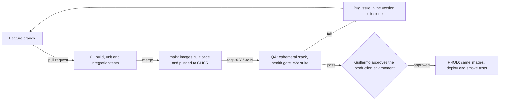

# ADR-0001: Environments and promotion

| | |
|---|---|
| **Status** | approved |
| **Target version** | gc-platform v0.1 (first applied in Alquiler v0.1) |
| **Date** | 2026-10-19 |
| **Approved** | 2026-10-19 |
| **Decider** | Guillermo (GchengC) |

## Context

GchengC is a one-person agency that builds microservice web applications (Spring Boot, Angular, PostgreSQL) for a public portfolio. Development happens on Windows 11. Containers run on Docker Desktop, which uses WSL 2 as its backend.

Every project needs a way to prove that a release works outside the developer's machine before it reaches production: that the images start, that the startup scripts and database migrations run, that the services find and talk to each other through the gateway, and that the known use cases still pass. Production hosting is not decided yet and will be covered by a separate ADR.

Constraints:

- One person; no shared environments are needed for collaboration.
- Free tiers wherever possible. Project repositories are public.
- The laptop runs the IDEs and the local stack, so long-lived replicas compete for memory.
- No promotion to production without Guillermo's explicit approval.
- Start small: the model must work for Alquiler v0.1 and grow by version.

## Decision drivers

1. **Production parity**: QA must exercise the same artifacts and the same startup procedure as production.
2. **Reproducibility**: a QA result must not depend on leftover state.
3. **Auditability**: each release candidate keeps a record of what was tested and the result.
4. **Cost**: no paid infrastructure for QA.
5. **Human approval** before production.

## Considered options

### Option 1: Local, DEV, QA and PROD as long-lived environments

The usual company layout.

- Pros: familiar; each environment can be inspected at any time.
- Cons: DEV duplicates what local development already covers for a single developer. Two long-lived replicas on the laptop double the memory cost. Long-lived environments drift.

### Option 2: Local, a long-lived QA on the laptop, and PROD

- Pros: QA is always available to inspect; simple to explain.
- Cons: the gate depends on the laptop's state (leftover data, manual changes, partial upgrades), so a pass is neither reproducible nor auditable. It runs only when someone starts it, and it uses laptop resources.

### Option 3: Local, QA defined as code, and PROD (chosen)

QA is defined once (Compose files, seed data and the end-to-end suite) and runs in two places:

- **In GitHub Actions, as the automatic gate**: an ephemeral stack is created for every release candidate, tested and destroyed.
- **On the laptop, on demand**: the same definition, to reproduce a failure or run exploratory agents.

- Pros: every run starts from zero, so it tests exactly the startup, migrations and service communication that production will need. The result is attached to the release candidate. Standard GitHub-hosted runners are free for public repositories and have 4 CPUs and 16 GB of RAM, enough for the full stack. It uses no laptop resources unless needed.
- Cons: there is no always-on QA URL; it has to be started locally when needed. Each gate run takes several minutes. End-to-end flakiness has to be managed.

## Decision

Adopt **Option 3**.

### Environments

| Environment | Where | Version | Purpose | Lifetime |
|---|---|---|---|---|
| Local | Windows, IDEs; infrastructure (PostgreSQL, etc.) in Docker Compose | Working branch | Develop and debug with hot reload | Always |
| QA | Ephemeral stack in GitHub Actions (the gate); the same stack on demand in Docker Desktop at `qa.<project>.localhost` | Release candidate `vX.Y.Z-rc.N` | Prove that the release starts, communicates and passes the known cases | Per run / on demand |
| PROD | Cloud, hosting decided in a separate ADR | Approved release `vX.Y.Z` | Public demo of the portfolio | Permanent |

### Promotion flow

### Rules

1. **Build once, promote the same image.** Every merge to `main` builds one image per service and pushes it to GitHub Container Registry as `ghcr.io/gchengc/<project>-<service>`, tagged with the commit SHA. A release candidate and its release point to the same digests; promotion re-tags, it never rebuilds.
2. **Same images, different configuration.** Configuration comes from Spring profiles (`local`, `qa`, `prod`) and environment variables. The frontend reads its configuration at runtime and calls the API through the gateway with relative paths, so the same frontend image is valid in every environment. Per-environment Angular builds are not allowed.
3. **Data.** Flyway migrations run the same way everywhere. QA starts from an empty database plus a deterministic seed dataset on every run. Test data never reaches production.
4. **Secrets.** Local secrets live in a git-ignored `.env`. QA uses throwaway values generated by the workflow. Production secrets live in the GitHub `production` environment.
5. **QA gate.** A release candidate passes only if:
   - every service starts from its image with the production startup procedure and reports healthy;
   - the gateway routes to every service, and service-to-service calls succeed;
   - the end-to-end suite for the version passes, with no skipped tests;
   - reports, traces and container logs are attached to the run.
6. **Failure path.** Any failure blocks promotion. Each defect becomes a `bug` issue in the version milestone, is fixed through the normal branch and pull request flow, and a new release candidate is tagged.
7. **Production approval.** The deploy job targets a GitHub environment named `production` that requires Guillermo as reviewer; the job waits until he approves. Deployment protection rules are available for public repositories on the free plan. Smoke tests run after every deployment.
8. **Traceability.** End-to-end tests are derived from the acceptance criteria (Given/When/Then) of the version's stories and tagged with the story's issue ID, so the QA report shows which stories were verified.
9. **AI agents.** Agents may plan, generate and repair tests, and may explore the local QA stack and propose issues. They never approve a promotion. Changes they make to tests go through a pull request like any other code, and a skipped test fails the gate: the Playwright healer may skip a test when it concludes the feature is broken, and in a gate that would hide a defect.

## Consequences

- QA results are reproducible and auditable at no infrastructure cost.
- Parity with production is only as strong as the production hosting allows. The hosting ADR should prefer platforms that run the same container composition.
- There is no permanent QA URL. Inspecting a release candidate means starting it locally.
- The end-to-end suite becomes a maintained asset. Its size per version is decided in planning, starting with the critical path.
- The pattern is generic and belongs to `gc-platform/template` (Compose files, workflows, runtime configuration). It grows only with what real projects need.

## Implementation phases

1. **gc-platform v0.1 and Alquiler v0.1.** Compose files (infrastructure only for local; full stack for QA), image build and push to GHCR, tag conventions, and the QA workflow with the health gate and an end-to-end test for the critical path.
2. **After the hosting ADR.** The production deploy job behind the `production` environment, plus smoke tests.
3. **Lab.** Playwright test agents for generating and repairing tests, an exploratory agent on local QA, and evals that compare both against the baseline.

## Open questions

- Production hosting (separate ADR).
- Test identities for authentication in QA.
- Whether a version ever needs a long-lived QA instance, for example for a demo.

## References

- [About GitHub's plans](https://docs.github.com/en/get-started/learning-about-github/githubs-plans)
- [GitHub-hosted runners](https://docs.github.com/en/actions/reference/runners/github-hosted-runners)
- [Self-hosted runners and public repositories](https://docs.github.com/en/actions/how-tos/manage-runners/self-hosted-runners/add-runners)
- [Playwright Test Agents](https://playwright.dev/docs/test-agents)
